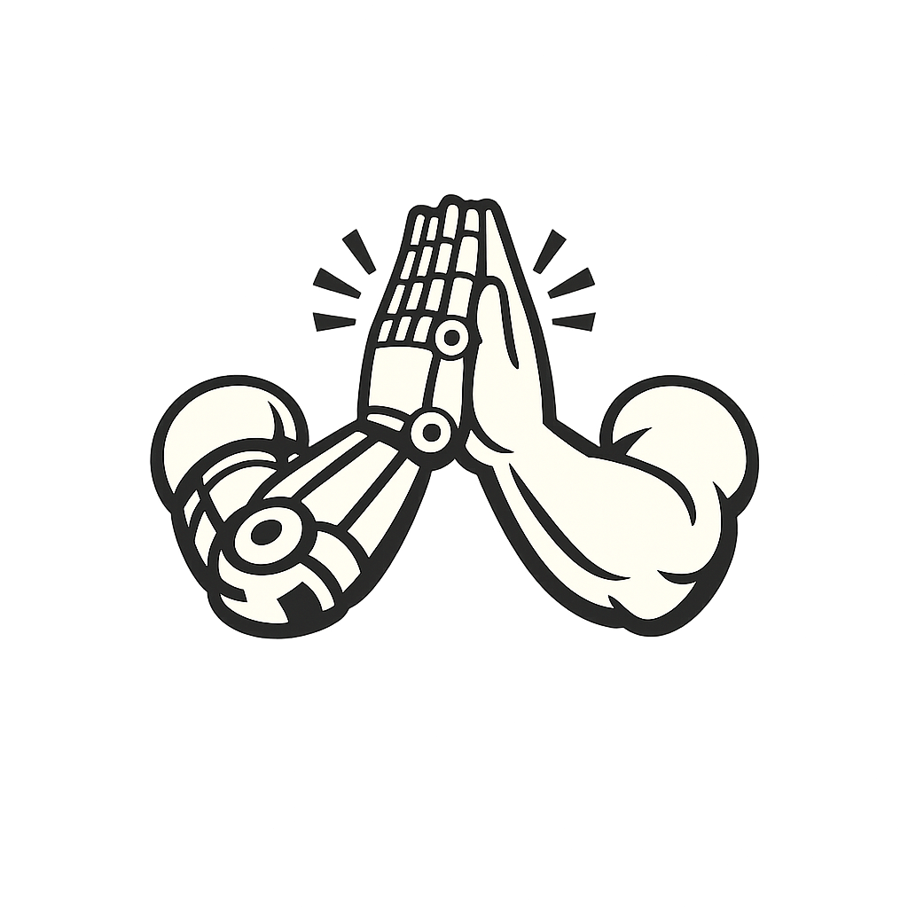
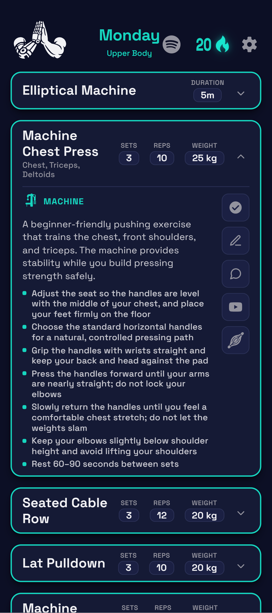
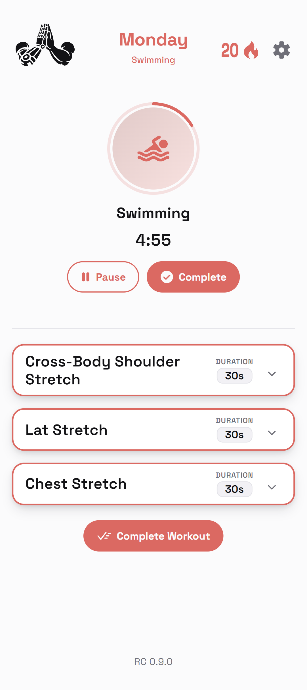
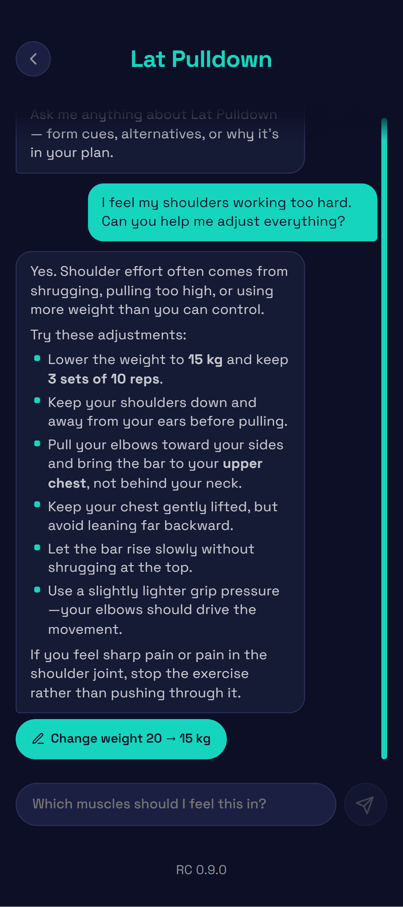
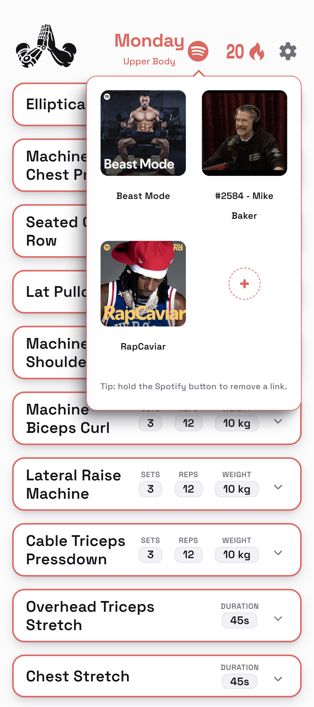
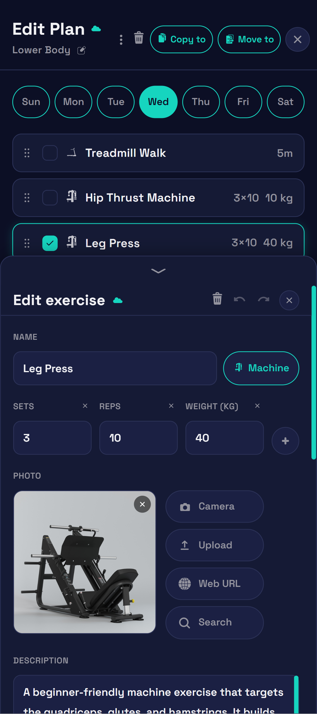
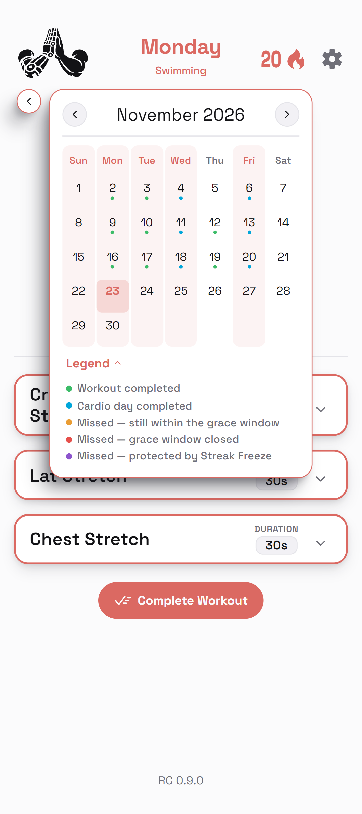

<div align="center">



# GymBuddy

**Your AI-powered workout companion.**
Build a weekly plan, tick off exercises, keep your streak alive.


</div>

> **A fan-made, personal project.** GymBuddy is a hobby app built for my own training. It is not affiliated with any gym, brand or fitness company.

<div align="center">
  <!-- Click a preview to open the full-size screenshot. -->
  <a href="screenshots/expanded_card.png"></a>
  <a href="screenshots/cardio.png"></a>
  <a href="screenshots/chat.png"></a>
  <a href="screenshots/music_shortcuts.png"></a>
  <a href="screenshots/plan_editor.png"></a>
  <a href="screenshots/month_view.png"></a>
</div>

## Features

- **AI-generated weekly plans.** Describe your goals and GymBuddy builds a full plan, which you can regenerate or fine-tune any time.
- **Edit Plan.** Rename days, reorder them, swap or add exercises, undo and redo changes, and export or import your whole plan.
- **Exercise cards.** Sets, reps and weight at a glance, with muscle highlighting, photos and a per-exercise rest timer.
- **Ask or swap.** Chat about any exercise, or swap it for an alternative with a reason.
- **Cardio days.** Pick an activity, like swimming or jogging, and give it an optional duration.
- **Music shortcuts.** Pin up to six Spotify links (playlists, albums, podcasts) so your workout soundtrack is a tap away.
- **Streaks.** Complete scheduled days to build a streak, with freezes and a catch-up flow for missed days.
- **Month view.** See every completed, missed and cardio day at a glance.
- **Installable PWA.** Add it to your home screen, use it offline, and get push notifications.
- **Multiple users, light and dark themes.**

## Tech stack

| Layer             | Tech |
| ----------------- | ---- |
| Frontend          | React 19, Vite, installable PWA |
| Backend           | Node.js, Fastify 5, built-in `node:sqlite` |
| AI                | OpenAI API (plans, chat, swaps) |
| Notifications     | Web Push |
| Optional services | Serper (exercise photos), YouTube Data API (exercise videos) |

## Getting started

### Prerequisites

- Node.js 24 or newer (the backend uses the built-in `node:sqlite`)
- An [OpenAI API key](https://platform.openai.com/api-keys)
- Optional: Serper and YouTube Data API keys, and VAPID keys for push notifications

### 1. Clone and install

```bash
git clone https://github.com/EdenTsarfaty/GymBuddy.git
cd GymBuddy

cd backend && npm install
cd ../frontend && npm install
```

### 2. Configure the backend

Copy `backend/.env.example` to `backend/.env` and fill it in:

```env
OPENAI_API_KEY=your-openai-key

# Optional
PORT=3001
# Addresses the app may be opened from, comma-separated (defaults to the local dev servers)
FRONTEND_ORIGIN=http://localhost:5173
SERPER_API_KEY=your-serper-key
YOUTUBE_API_KEY=your-youtube-key
VAPID_PUBLIC_KEY=
VAPID_PRIVATE_KEY=
VAPID_SUBJECT=mailto:you@example.com
```

### 3. Run it

```bash
# terminal 1
cd backend
npm run dev

# terminal 2
cd frontend
npm run dev
```

Open <http://localhost:5173>. The database is created on first run in `backend/data/`.

### Using it on your phone (optional)

The backend is a plain server, so you can run it on a home machine or laptop and open the app from your phone. [Tailscale](https://tailscale.com) is a convenient way to do that without exposing anything to the public internet: install it on both devices, and use `tailscale serve` for an HTTPS address (installing the PWA and push notifications need HTTPS). By default the frontend looks for the backend on the same host, port 3001, and `FRONTEND_ORIGIN` in `backend/.env` should list the address you open the app from (comma-separated if there are several). None of this is required to run GymBuddy locally.

## Project structure

```
GymBuddy/
├── backend/    Fastify API, SQLite database, OpenAI and push integrations
├── frontend/   React PWA (Vite)
```

## Roadmap

- [ ] Offline queue for every completion (exercise ticks and Complete Workout)
- [ ] Duration tracking for gym days (behind a Settings toggle)
- [ ] Google Health sync
- [ ] Coins and rewards
- [ ] AI-driven progression suggestions

## Contributing

This is a personal project, but bug reports and ideas are welcome. Open an issue and say what you were doing and what you expected. Pull requests are fine for small fixes; for anything bigger, please open an issue first.

## Acknowledgments

- Activity icons come from third-party icon artists; all rights stay with their creators. If one is yours and you'd like a credit (or removal), please open an issue.
- Muscle diagrams by [react-muscle-highlighter](https://www.npmjs.com/package/react-muscle-highlighter).
- Exercise name suggestions come from [wger](https://wger.de), an open, community-maintained workout manager. Thank you to its contributors.
- Photos and videos are fetched from third-party services; all rights stay with their owners.

## License

Released under the [MIT License](LICENSE). Free to use, modify and share.
